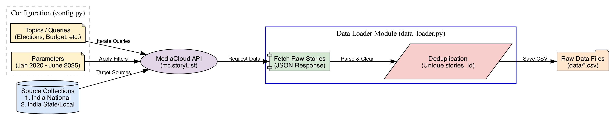
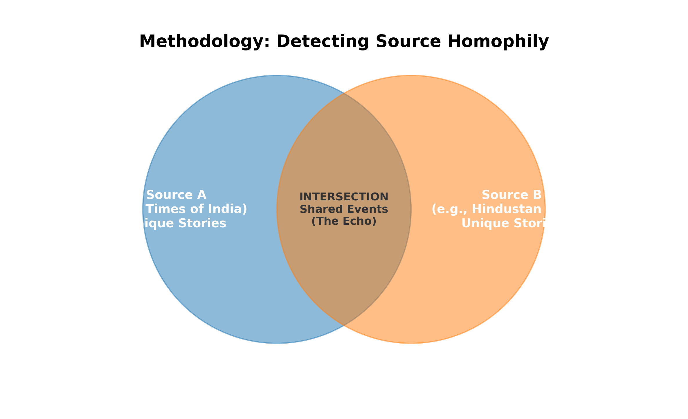
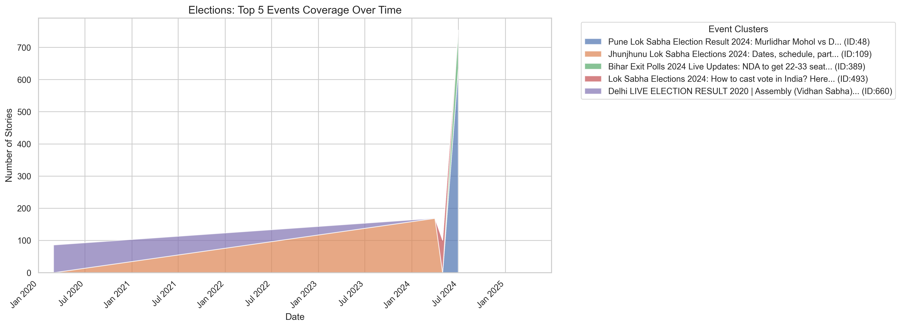
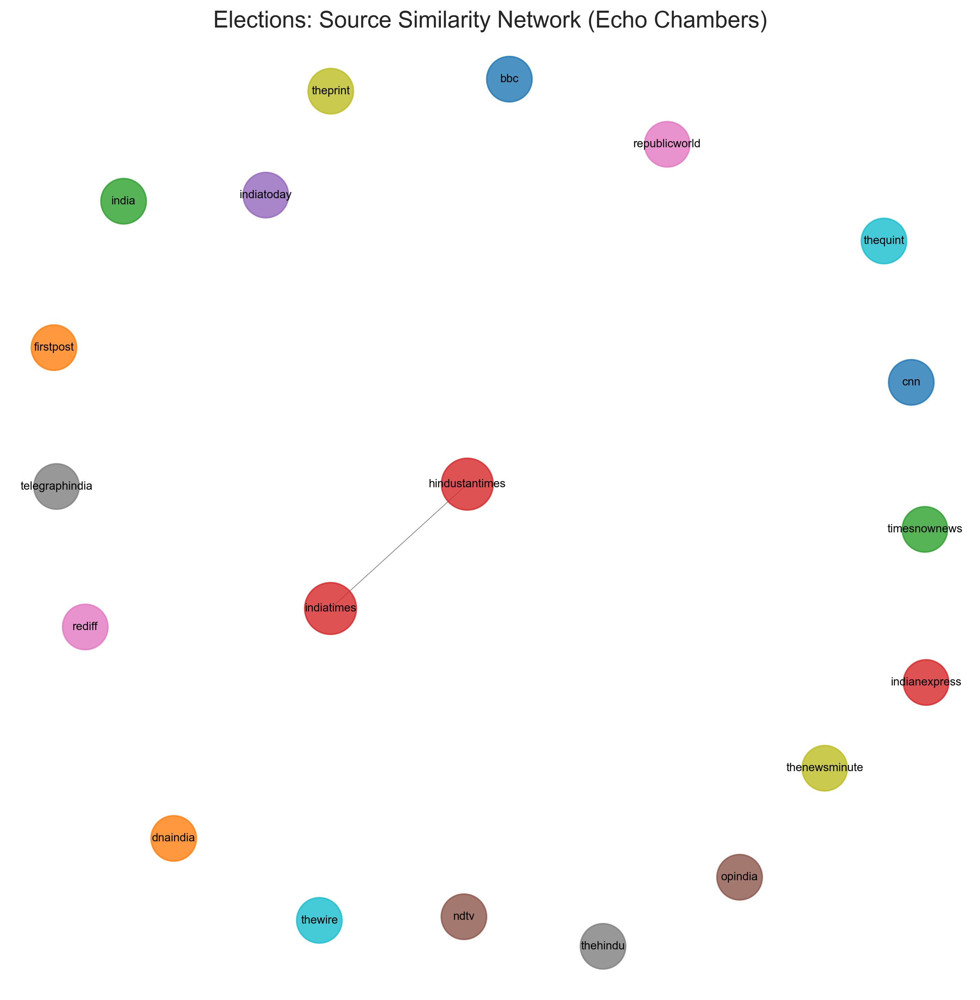
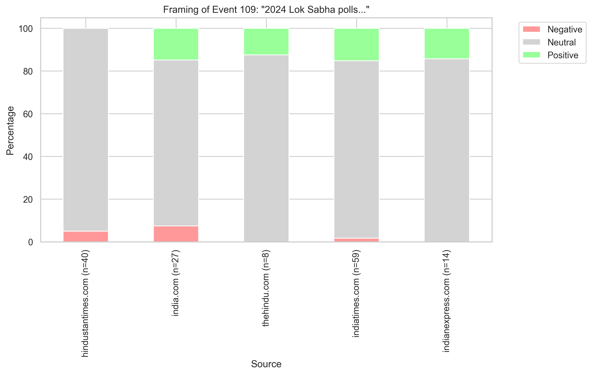
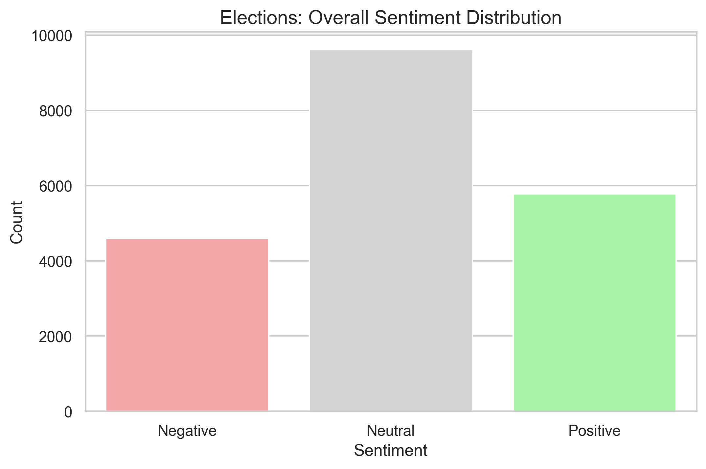
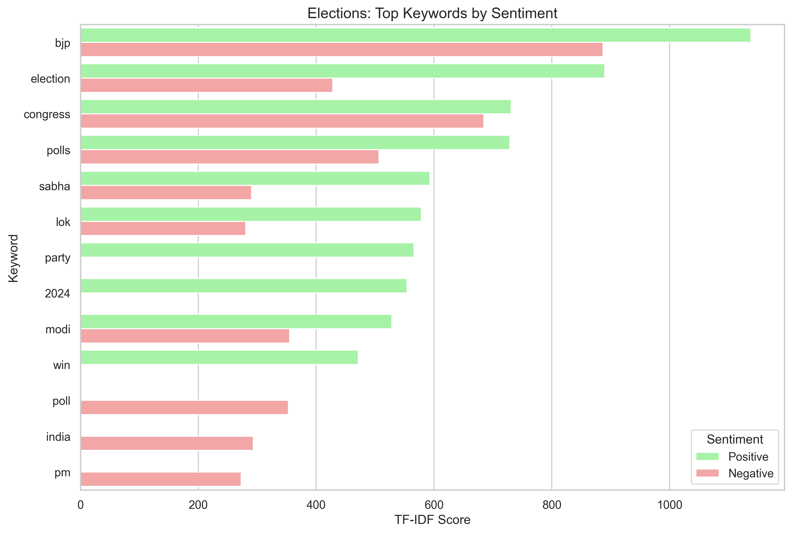
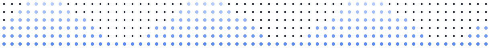

<p align="center">
  <b>Who gets covered, how much, and how it is framed, across Indian news.</b><br>
  <sub>Gatekeeping, coverage and framing, not political lean · Python, SBERT, VADER, NetworkX · Ashoka University capstone, Monsoon 2025</sub>
</p>

### at a glance

```yaml
what:    measures gatekeeping, coverage and framing in Indian news; it does not score political lean
data:    MediaCloud stories, bundled as data/*.csv (5 topics)
method:  SBERT event threading with time decay, VADER sentiment, TF-IDF, Jaccard source networks
stack:   [Python, sentence-transformers, scikit-learn, VADER, NetworkX, matplotlib]
built:   Monsoon 2025 · solo capstone, Ashoka University
paper:   method follows Saez-Trumper, Castillo & Lalmas (2013), see "reference paper" below
```

Beyond simple volume counts, the pipeline looks at **agenda setting** (what is covered) and **framing** (how it is covered). Stories are grouped into events, then compared across outlets by volume, overlap and tone.

<table>
  <tr>
    <td width="50%"></td>
    <td width="50%"></td>
  </tr>
  <tr>
    <td align="center"><sub>data collection flow</sub></td>
    <td align="center"><sub>how source overlap is scored (Jaccard)</sub></td>
  </tr>
</table>

### method

**1. Data.** Stories come from the **MediaCloud API** (the pipeline reads the CSVs saved from it).

- Collections: India National `34412118`, India State/Local `38379954`.
- Topics are defined in `config.py`: `Elections`, `Budget`, `Supreme Court`, `Military`, `Foreign Policy`.
- Configurable limit (default 20,000 stories per topic). Stories are deduplicated by ID, since sources can sit in both collections.
- Date range in `config.py`: 2020-01-01 to 2025-06-30.

**2. Clustering: event threading with time decay.** Inspired by _Nallapati et al. (2004)_, so a single event can be tracked over time.

- Headlines are embedded with **SBERT** (`all-MiniLM-L6-v2`, 384 dimensions).
- A long-running event (a multi-day vote count, say) would otherwise split into separate clusters, so similarity decays with the gap in days:

  ```
  similarity = (1 - cosine_distance) * exp(-alpha * delta_t)      alpha = 0.15
  ```

- Same-day stories only need to be semantically similar to cluster together. Stories five days apart must be nearly identical.
- **Agglomerative clustering** (average linkage) on this distance matrix, threshold `0.5`.

### what it produces

The Elections topic is the case study below. Every topic gets the same five outputs in `output/`.

**Coverage bias (agenda setting).** Volume of stories per event cluster over time, as a stacked area chart.



**Source network (echo chambers).** Nodes are the top 20 sources; edges are weighted by the **Jaccard similarity** of the story clusters they cover. Thick edges mean a similar agenda.



**Event framing.** Sentiment distribution of the top 5 sources inside one event cluster, showing how different outlets frame the same event.



<details>
<summary>Statement bias (VADER sentiment) and keywords (TF-IDF)</summary>

<br>

**Statement bias.** Ratio of positive to negative headlines, scored with **VADER**.



**Keywords.** Dominant vocabulary, extracted with TF-IDF.



</details>

### run it

The MediaCloud API needs a key, but the stories are already in `data/*.csv`, and `modules/data_loader.py` reads those. `config.py` still insists on `MC_API_KEY` being set, so any placeholder value works for the bundled data.

```bash
pip install -r requirements.txt
echo "MC_API_KEY=your_api_key_here" > .env      # placeholder is fine with the bundled CSVs
python main.py
```

Results land in `output/`. `main.py` clears `output/` first and then runs all five topics; the full set needs several GB of RAM (the Elections distance matrix is about 22k by 22k). To try one topic quickly, copy `main.py`, `config.py`, `modules/` and a single CSV (for example `data/military.csv`) to a scratch folder; topics with no CSV are skipped. The same trick works for any topic.

### project structure

- `main.py`: entry point, runs the full pipeline.
- `config.py`: API key, collection IDs, date range, search queries.
- `modules/data_loader.py`: loads stories per topic.
- `modules/clustering.py`: event threading with time decay.
- `modules/analysis.py`: sentiment, keywords, source network.
- `modules/visualization.py`: plots.
- `data/`: bundled stories, one CSV per topic.
- `output/`: generated reports, JSON exports and figures.

### reference paper

The three kinds of bias measured here (gatekeeping, coverage, statement bias) come from Saez-Trumper, Castillo and Lalmas, _Social Media News Communities: Gatekeeping, Coverage, and Statement Bias_ (CIKM 2013): [`research paper.pdf`](research%20paper.pdf).


